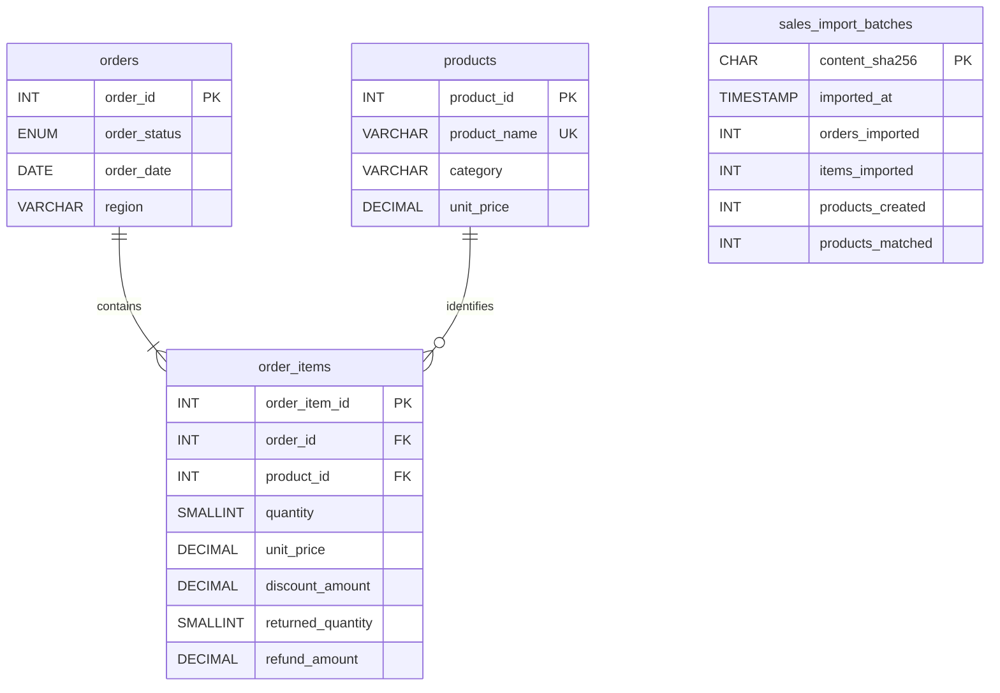

# Entity-relationship diagram

The diagram represents the sales tables and import-fingerprint table created by
[`setup_and_seed.sql`](../database/setup_and_seed.sql).

## Relationships

- One order has one or more order-item lines. Each order-item line belongs to
  exactly one order.
- One product can appear in zero or more order-item lines. Each order-item line
  refers to exactly one product.
- The pair `(order_id, product_id)` is unique in `order_items`, so a product
  appears at most once in a particular order.
- `order_items.order_id` references `orders.order_id`;
  `order_items.product_id` references `products.product_id`.
- `sales_import_batches` has no sales-table foreign key. Its content hash is a
  transactional idempotency marker for normalized CSV row sets.
