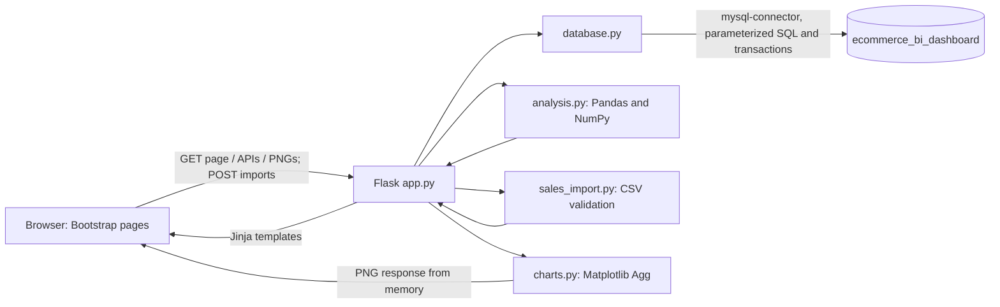

# System Design

## Architecture

## Components

- **`app.py`:** Flask application factory and routes. It renders the welcome
  page and dashboard, validates filters and import previews, requires a
  separate confirmation for CSV writes, returns JSON APIs, and serves chart
  images.
- **`config.py`:** Reads MySQL connection settings from the project `.env`
  file. Credentials are not stored in Python source.
- **`database.py`:** Opens connections, executes parameterized analytics
  queries, adds products, and persists sales imports transactionally. Sales
  queries join the three sales tables; imports use a fingerprint table to
  prevent repeat imports.
- **`sales_import.py`:** Parses UTF-8 CSV input, validates the supported schema
  and line business rules, groups product rows by order reference, and creates
  a canonical content fingerprint for duplicate-import prevention.
- **`analysis.py`:** Validates joined rows and produces summary KPIs, monthly
  revenue/growth, category and regional summaries, top products, and
  descriptive data-driven insights using Pandas and NumPy.
- **`charts.py`:** Creates Matplotlib figures using the noninteractive Agg
  backend and returns PNG bytes through an in-memory stream.
- **`templates/` and `static/css/style.css`:** Render the responsive,
  server-side welcome, import, product, and dashboard pages and shared error
  layout. Bootstrap 5 CSS is loaded from its CDN.
- **`tests/`:** Unit and Flask test-client coverage. Database/API tests use
  mocks where noted in the test documentation.

## Database design

The schema is created by [`../database/setup_and_seed.sql`](../database/setup_and_seed.sql).

### `orders`

One row per order: `order_id` primary key, `order_status`, `order_date`, and
`region`. Status is one of `completed`, `delivered`, or `cancelled`.

### `products`

One row per catalog product: `product_id` primary key, unique `product_name`,
`category`, and positive catalog `unit_price`.

### `order_items`

One row per product line: `order_item_id` primary key, `order_id` and
`product_id` foreign keys, `quantity`, `unit_price`, line-total
`discount_amount`, `returned_quantity`, and recorded line-total
`refund_amount`.

One order can have multiple item lines; one product can occur on multiple
orders. The pair `(order_id, product_id)` is unique. InnoDB foreign keys prevent
deleting referenced orders or products. The data dictionary contains each
column's types, constraints, and definitions.

### `sales_import_batches`

One row per committed normalized CSV content fingerprint. Its SHA-256 primary
key prevents the same logical row set from being imported twice. The import
marker, orders, products, and order items are committed in one transaction;
failed writes are rolled back. It is an import-control table and does not
replace or alter existing sales rows.

## Request and calculation flow

1. The browser loads `/` for the welcome page, `/dashboard` for sales reporting,
   or `/imports` to begin a CSV upload.
2. The import preview route applies size and schema checks, validates order
   grouping and line amounts, and stages only a valid preview in process memory.
   A separate confirmation request is required before database writes.
3. `database.import_sales_rows()` inserts the fingerprint marker, creates or
   matches products, groups lines into orders, inserts order items, and commits
   the complete batch in one transaction.
4. For analytics, Flask validates any `start_date` and `end_date` values as
   `YYYY-MM-DD` and rejects malformed or reversed ranges with HTTP 400.
5. `database.fetch_sales_data()` queries `orders`, `order_items`, and
   `products`. Date, category, and region filters are bound as parameters.
6. `analysis.analyze_sales()` computes line gross sales, then subtracts the
   line discount and recorded refund once, excludes cancelled orders, and
   aggregates the eligible rows and data-driven insights.
7. The page renders KPI cards, insights, and summary tables. Chart routes pass the same
   analytics response data to the Matplotlib chart helper and return PNG
   content from memory.
8. Database/configuration errors return safe HTTP error responses; chart
   generation errors are logged server-side and return an understandable page
   message.

## HTTP route summary

### Browser and health

- `GET /` — welcome page.
- `GET /dashboard` — dashboard with optional date, category, and region filters.
- `GET /imports` — CSV import form.
- `POST /imports/preview` — validates and previews an upload without writing.
- `POST /imports/confirm` — transactionally imports a confirmed preview.
- `GET /imports/sample.csv` — sample import template download.
- `GET /health` — database connectivity response.

### Data APIs

- `GET /api/products`
- `GET /api/orders`
- `GET /api/order-items`

These list routes accept `limit` (1–500) and `offset` (zero or greater).

### Analytics APIs

- `GET /api/analytics`
- `GET /api/analytics/summary`
- `GET /api/analytics/monthly-revenue`
- `GET /api/analytics/category-sales`
- `GET /api/analytics/region-sales`

The analytics routes accept the same optional inclusive date-range parameters
as the dashboard.

### Charts

- `GET /charts/monthly-revenue.png`
- `GET /charts/category-sales.png`
- `GET /charts/region-sales.png`

Date, category, and region filters also apply to chart requests. The chart name
is restricted to the three supported types.
